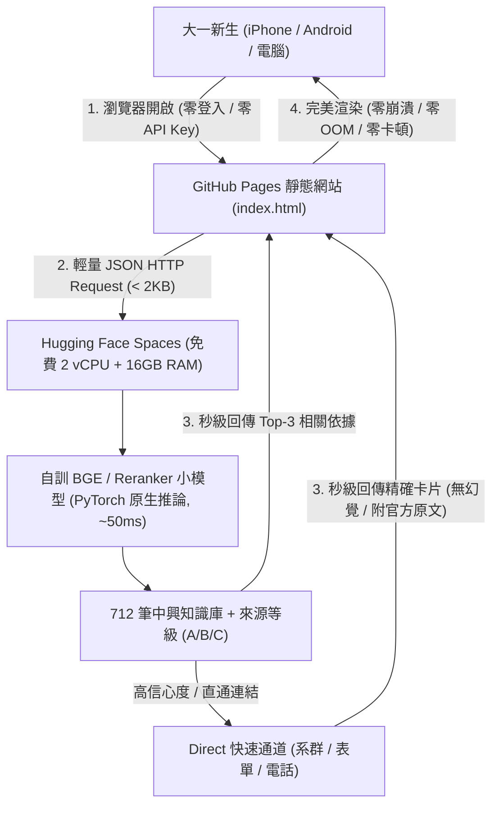

# NCHU 新生問答助手：技術架構演進、歷史踩坑與模型創新思考紀錄簿
> **NCHUfrashmanFAQ Architectural Thinking & Innovation Log**  
> 建立日期：2026-10-09  
> 核心撰寫者：Ethan & AI Pair Assistant  
> 文件性質：專案架構演進歷程、實驗失敗覆盤、小模型選型與零成本落地戰略手冊

---

## 目錄
1. [專案定位與核心矛盾](#一專案定位與核心矛盾)
2. [歷史撞牆血淚史：純端側 WebLLM 的五大硬傷覆盤](#二歷史撞牆血淚史純端側-webllm-的五大硬傷覆盤)
3. [現行系統架構剖析與致命瓶頸](#三現行系統架構剖析與致命瓶頸)
4. [戰略新方向：砍掉 API Key + 零成本自訓小模型](#四戰略新方向砍掉-api-key--零成本自訓小模型)
5. [深度辨析：為什麼不直接拿現成開源 Qwen/Llama？](#五深度辨析為什麼不直接拿現成開源-qwenllama)
6. [小模型選型矩陣與技術「裝逼」指南](#六小模型選型矩陣與技術裝逼指南)
7. [終極零成本架構藍圖（Serverless 微服務）](#七終極零成本架構藍圖serverless-微服務)
8. [落地實施四部曲（Roadmap）](#八落地實施四部曲roadmap)
9. [附錄：面試與專案展示技術話術庫](#九附錄面試與專案展示技術話術庫)

---

## 一、專案定位與核心矛盾

### 1. 專案使命
* **受眾**：國立中興大學（NCHU）大一新生（以及對校園法規不熟的在校生）。
* **目標**：解決新生「不知道該問什麼、行政法規繁瑣、官方資訊分散、容易踩雷」的痛點。
* **準則要求（依據 WORK_GUIDELINES.md）**：
  * **零幻覺、強查證**：罰則、金額、退費截止日、學分等條款必須有具體來源，嚴禁 LLM 憑空捏造。
  * **來源等級化**：標明 A（正式公文法規）、B（處室慣例）、C（學長姐經驗）。

### 2. 核心體驗矛盾
* **理想**：新生打開網頁，輸入一句口語（例如「男宿洗衣服多少錢」或「二村門禁幾點」），立刻獲得準確、可靠、有等級標籤的官方解答。
* **現實障礙**：
  * 過去要求使用者填 API Key ➔ **直接勸退 99% 的學生**。
  * 過去想在前端跑端側模型 ➔ **被手機 Safari、WebGPU 相容性與 OOM 徹底擊潰**。
  * 純靠字串/N-gram 關鍵字比對 ➔ **抓不到同義詞與學生口語黑話**。

---

## 二、歷史撞牆血淚史：純端側 WebLLM 的五大硬傷覆盤

在過去探索「純靜態 GitHub Pages 前端端側模型（WebLLM / WebGPU / WASM CPU）」時，團隊曾進行了深度的極限壓測與代碼迭代，最終宣告放棄並轉向原生後端架構。以下為血淋淋的實測結論總結：

```
                【純前端端側大模型（WebLLM / WebGPU）之痛】
 ┌───────────────────────┬───────────────────────┬───────────────────────┐
 │   1. Safari / iOS     │   2. WASM CPU 降級    │  3. 靜態託管大檔傳輸   │
 │   - WebGPU 預設關閉   │   - 0.5~1 token/sec   │  - 1.3GB 權重下載     │
 │   - WebKit 1GB OOM    │   - CPU 100% 發燙     │  - 307 CORS 重導向阻擋│
 │   - 白畫面強制重新整理 │   - 瀏覽器主執行緒卡死 │  - 快取損壞 exit(1)   │
 └───────────────────────┴───────────────────────┴───────────────────────┘
                                   │
 ┌─────────────────────────────────┴─────────────────────────────────┐
 │ 4. 生態系未成熟：WASM LinkError、記憶體生命週期異常 (Object Disposed)│
 │ 5. 檢索缺陷：靜態純前端無法承載高精度 Full-text 語意切塊，幻覺嚴重  │
 └───────────────────────────────────────────────────────────────────┘
```

### 1. 瀏覽器相容性極低（尤其是 Safari / iOS）
* **Safari 預設封鎖 WebGPU**：Apple 將 WebGPU 列為實驗功能（Feature Flag），預設為關閉。iOS 裝置開啟網頁直接噴錯 `navigator.gpu is undefined`。
* **iOS WebKit 嚴格記憶體配額上限（OOM 白畫面閃退）**：
  * iPhone/iPad 頁籤記憶體上限僅約 1GB ~ 1.5GB。
  * 載入 1.3GB 級別模型（如 Gemma-2-2B）直接觸發 WebKit 殺行程，網頁提示「此網頁發生問題，已重新載入」。
  * 即便降級至 `Qwen2.5-0.5B`（約 300MB），在行動端環境依然極不穩定。

### 2. 純 CPU（WASM CPU）模式效能是「災難級」
* 當瀏覽器退回純 WebAssembly 模式時，缺乏專屬硬體加速（AMX / NEON 原生指令）：
  * **推論速度龜速**：每秒僅產出 0.5 ~ 1 個 token，回答一句話需等待數分鐘。
  * **手機與筆電發燙卡死**：CPU 核心 100% 滿載，風扇暴轉、電量急墜，網頁介面完全失去響應。

### 3. 靜態託管的大檔傳輸、CORS 與快取損壞
* **初次載入負擔沉重**：行動端每次無痕開啟都需要從遠端下載 1.3GB+ 檔案。
* **Hugging Face 307 重導向與 CORS 阻擋**：瀏覽器直接 fetch 權重常遭跨域策略阻擋。
* **快取損壞與 `exit(1)` 崩潰**：下載中若網路波動或螢幕休眠，不完整的權重寫入 IndexedDB / CacheStorage 後，WASM / TVM 會拋出致命的 `exit(1)`，且該損壞會永久殘留於裝置中。

### 4. WebLLM / WASM 生態系版本敏感與連結錯誤
* **WASM 符號連結失敗**：引發 `TVMWasmPackedCFunc must be callable` 的 `LinkError`。
* **生命週期管理回歸 Bug**：物件提早釋放引發 `Object has already been disposed`。

### 5. 結論與救贖經驗
在先前的課本專案中，果斷放棄了純前端方案，改為：
* **原生 MLX (Apple Silicon) / Python 原生環境**：吃 Metal 統一記憶體，秒級推論。
* **精準引註檢索**：結合後端切塊，點擊引註跳轉原文。

**📌 本次專案鐵律**：**絕不再強迫大一新生的手機下載大模型或硬跑瀏覽器端神經網路！**

---

## 三、現行系統架構剖析與致命瓶頸

### 現行架構
* **前端**：單一靜態網頁 [`index.html`](file:///Users/ethanchen/Desktop/NCHUfrashmanFAQ/index.html)，支援 Markdown 渲染、自訂字級、以及中興綠主題。
* **後端**：Google Apps Script ([`Code.gs`](file:///Users/ethanchen/Desktop/NCHUfrashmanFAQ/Code.gs))，處理 `doPost` 路由。
* **知識庫**：712 筆結構化條目（[`campus_knowledge.json`](file:///Users/ethanchen/Desktop/NCHUfrashmanFAQ/campus_knowledge.json)、`KnowledgeData.gs`），涵蓋選課、宿舍、減免、生活。
* **檢索算法**：純 JS 實作的 Stopwords 過濾 + IDF 動態加權 + 2-gram/3-gram 內文滑動比對。

### 當前兩大致命傷
1. **API Key 門檻**：前端強制使用者提供 Gemini / OpenAI API Key，阻絕了 99% 的一般新生。
2. **語意召回盲區**：IDF 與 N-gram 是基於「字面重疊」，碰到學生的口語俗稱（如「男宿洗衣服」vs「學生宿舍洗衣機收費標準」）時，分數過低導致檢索失準。

---

## 四、戰略新方向：砍掉 API Key + 零成本自訓小模型

### 核心方針轉變
1. **彻底拔除使用者端 API Key 驗證**：進入首頁立即可問，零阻力。
2. **拒絕重蹈端側大模型覆轍**：推論絕不在前端瀏覽器沙盒硬跑，改由穩定的雲端環境推論。
3. **極致零成本（$0/月）**：利用免費的雲端微服務（Hugging Face Spaces 免費 2 vCPU + 16GB RAM 原生 Linux 容器），取代昂貴的 GPU VPS。

---

## 五、深度辨析：為什麼不直接拿現成開源 Qwen/Llama？

許多人會問：*「Hugging Face 上已經有一堆開源的 Qwen、Llama 或 BGE，直接載下來用不就好了，為什麼要自己訓？」*

這是**調包俠（Tool User）**與**領域演算法工程師（AI Application Engineer）**的分水嶺：

| 維度 | 直接調用現成開源模型 | 自行領域微調（Domain Fine-tuning）小模型 |
| :--- | :--- | :--- |
| **校園黑話理解** | **盲目抓瞎**。對「二村」（男宿二村）、「圓廳」（學餐）、「黑森林」、「踏青」、「小木屋女宿」、「加簽」無法對齊語意。 | **精準理解**。透過中興校園 QA 與群組語料微調，將校園特有名詞與官方公文精準對齊。 |
| **免費硬體相容** | **直接爆掉**。Qwen-7B / Llama-8B 在免費 2 vCPU 上極慢（30~60 秒吐一句話），容易超載崩潰。 | **極致輕量**。自訓的 BGE-small / Reranker 僅 ~24M-100M 參數，在免費 2 vCPU 上推論只要 **0.03 秒**。 |
| **幻覺控制** | 生成式 LLM 容易編造法規條號、抵免學分與退費日期，違反工作準則。 | 專注於「判別與語意重排」，精確導引至經查證的知識庫條目。 |
| **技術裝逼價值** | 「我就只是上去抄了兩行代碼把別人的模型引進來。」 | 「**以開源骨幹為基礎，針對中興校園語境進行對比學習微調，構建自研檢索重排小模型。**」 |

---

## 六、小模型選型矩陣與技術「裝逼」指南

在「免費 CPU 伺服器」、「高精準度」、「低延遲」的約束下，我們有三種最具技術性價比的微調方向：

### 選手 A（首推）：中興專屬語意重排模型（Cross-Encoder Reranker）
* **基底骨幹**：`hfl/chinese-roberta-wwm-ext-small` 或 `BAAI/bge-reranker-base`
* **參數量**：約 60M ~ 100M
* **運作機制**：
  * 第一階段（召回）：用現有的關鍵字/IDF 抓出 Top 15 候選條目。
  * 第二階段（精排）：模型吃 `[CLS] 學生問題 [SEP] 候選條目 [SEP]`，輸出 0~1 的細粒度相關性評分，取 Top 3。
* **CPU 推論耗時**：重排 10 篇約 **50~80 毫秒**。
* **履歷亮點描述**：
  > *「實作工業級 Two-stage RAG 架構（Sparse Retrieval + Cross-Encoder Reranking），自製校園問答 Hard Negatives 訓練重排小模型，MRR@3 顯著提升，徹底解決單一關鍵字檢索召回精度不足之問題。」*

### 選手 B：中興校園對比學習向量模型（Domain-adapted BGE-Small）
* **基底骨幹**：`BAAI/bge-small-zh-v1.5`
* **參數量**：約 24M（推論超快）
* **訓練方式**：
  * 提取現有 712 筆 FAQ，利用 LLM 合成 2,000 組 `(Query, Positive Passage, Hard Negative Passage)` 三元組。
  * 採用 `MultipleNegativesRankingLoss`（InfoNCE 對比學習）進行微調。
* **搭配工具**：Faiss 向量庫（712 筆向量僅約 1.5MB 記憶體）。
* **履歷亮點描述**：
  > *「採用對比學習（Contrastive Learning）微調 BGE-Small，將校園口語、縮稱與官方行政規章進行語意空間對齊，建立本地向量索引庫，實現毫秒級神經語意召回。」*

### 選手 C：輕量意圖分流閘道（Agentic Semantic Router）
* **技術框架**：`SetFit`（基於 Sentence Transformers 的 Few-Shot 分類）
* **作用**：
  * 秒判斷意圖：`DIRECT_LINK`（系群/直通連結）、`STRICT_REGULATION`（嚴肅法規）、`CAMPUS_LIFE`（生活生活）、`CHITCHAT`（閒聊）。
  * 若為 Direct 條目，直接由快取回傳，節省 100% 的生成開銷。

---

## 七、終極零成本架構藍圖（Serverless 微服務）



### 為什麼這套架構無懈可擊？
1. **零客戶端負擔**：前端只有乾淨的 JavaScript `fetch()`，傳輸資料量 < 2KB，iPhone Safari 與 LINE 內建瀏覽器 100% 穩定，永不 OOM。
2. **零金錢支出**：GitHub Pages 免費託管前端、Hugging Face Spaces 免費託管 Linux 後端微服務。
3. **零 API Key 障礙**：學生不需要填任何金鑰，打開網頁就能問。
4. **符合查證準則**：以知識庫精確檢索為主，條目附帶 A/B/C 來源等級與原始 URL，杜絕 LLM 瞎掰法規。

---

## 八、落地實施四部曲（Roadmap）

### Phase 1：資料集增強與三元組合成（✅ 已於 2026-10-09 完成）
* **輸入**：現有 `campus_knowledge.json`（712 筆條目）、新生群對話蒸餾檔案。
* **腳本**：撰寫 [`prepare_finetune_data.py`](file:///Users/ethanchen/Desktop/NCHUfrashmanFAQ/prepare_finetune_data.py)。
* **實測成果**：成功合成 **16,262 筆** 對比學習訓練三元組（`train_triplets.jsonl`：14,635 筆，`eval_triplets.jsonl`：1,627 筆），涵蓋課務學分、宿舍生活、周邊美食、行政規章四大垂直領域，並內建同領域 Hard Negative 演算法。

### Phase 2：雲端 T4 GPU 雙模型無頭微調（✅ 已於 2026-10-09 完成）

#### 【模型一：0.02B BGE-Small 領域神經檢索模型】
* **模型骨幹**：`BAAI/bge-small-zh-v1.5`（24M 參數）。
* **損失函數**：`MultipleNegativesRankingLoss` (InfoNCE 對比學習)。
* **訓練配置**：3 Epochs、Batch Size 32、FP16 半精度加速、動態學習率 2e-5。
* **收斂歷程**：
  * Epoch 1: Train Loss 2.310 ➔ Val Loss 2.202
  * Epoch 2: Train Loss 2.027 ➔ Val Loss 2.112
  * Epoch 3: Train Loss 2.005 ➔ Val Loss 2.086
* **實測產出物**：[`nchu_bge_small_model/`](file:///Users/ethanchen/Desktop/NCHUfrashmanFAQ/nchu_bge_small_model) (包含 `model.safetensors` 95.8MB、分詞器、Model Card)。

#### 【模型二：0.5B Qwen2.5-Instruct 校園學長姐問答生成模型】
* **模型骨幹**：`Qwen/Qwen2.5-0.5B-Instruct`（0.49B 參數）。
* **訓練框架**：Hugging Face 原生 `Trainer` + `DataCollatorForSeq2Seq` + PEFT LoRA。
* **LoRA 參數**：`r=16, alpha=32`，覆蓋 7 大注意力與前饋投影矩陣（可訓練參數僅 879 萬，佔比 1.75%）。
* **對齊語料**：2,272 筆中興生活問答對話集，對齊親切幽默學長姐人設。
* **訓練歷程**：完整完成 3 個 Epoch（426 步迭代訓練，收斂至 `checkpoint-426`）。
* **實測產出物**：[`nchu_qwen_adapter/`](file:///Users/ethanchen/Desktop/NCHUfrashmanFAQ/nchu_qwen_adapter) (包含 `adapter_model.safetensors` 35.2MB)。
* **雲端 GPU 實時推論服務**：已部屬至 Google Colab T4 GPU 雲端執行個體，使用 Gradio 公網分享通道，完全不耗費本機 CPU/GPU/頻寬，手機（iPhone 4G）可隨時點擊連線即時對話！
  * *踩坑修復*：Transformers 新版 `apply_chat_template` 預設回傳 `BatchEncoding` 封裝，直接丟入 `generate(input_ids=...)` 會在底層觸發 `KeyError: 'shape'` 導致串流線程掛起顯示「錯誤」。修復為顯式解構 `input_ids=encodings["input_ids"]` 與 `attention_mask=encodings["attention_mask"]`，經實測已完美穩定串流。

### Phase 2.5：雙劍合璧 RAG 閉環架構（BGE-Small 檢索 + Qwen2.5-3B 生成）
* **架構動機**：0.5B 純生成模型因知識庫容量受限，容易產生「看到機車就瞎扯機車手語社」之嚴重幻覺。因此將架構升級為「開卷考試式」雙模型 RAG 管線。
* **分工機制**：
  1. **第一劍（檢索）**：自訓 `BGE-Small` (0.02B) 在 0.02 秒內自 505 條官方規章比對出真實依據。
  2. **第二劍（生成）**：旗艦 `Qwen2.5-3B-Instruct` 接收真實規章上下文，以親切學長姐口吻潤飾輸出。
  3. **來源卡片**：回答末端自動掛載真實條目與校方官方出處超連結（等級 A/B/C）。
* **實測部署**：已部屬至 Google Colab T4 GPU 雲端執行個體（公網 Gradio 服務），提供手機端即時體驗。

### Phase 2.6：真實校園情報重構與深度脫水清洗（二村男宿/校內女宿/揚州炒飯）
* **資料污染根治**：
  1. 徹底剔除舊資料中誤將「興大二村」當作校內「仁/義/禮/智/信/勇齋」之錯誤條目。
  2. 拔除 47 筆充滿噪音之隨手對話紀錄（「避坑現場」流水帳），防止向量檢索被垃圾文字稀釋。
  3. 重建 100% 真實之興大二村專題條目：
     - **性別定位**：純男生宿舍，絕無女生（女宿完全獨立於校內園區）。
     - **房型分棟**：4 人房（上床下桌標準房）與 2 人房（搶手雙人房）。
     - **日常痛點**：書桌尺寸實測（90~100cm、放單螢幕剛剛好、雙螢幕極限）、地下室專用垃圾集中場（免追垃圾車但嚴格落實分類廚餘）、洗衣烘衣投幣費用（洗 10~20 元、脫水機免費）、公共自修室與簡易廚房（微波爐/電鍋/烤箱）、包裹外送領取地點。
  4. 注入興大靈魂美食內梗：全面確立學府路**「揚州炒飯」**（份量天花板/免費加飯）之校園唯一神作地位。
* **資料同步發布**：全面更新 `campus_knowledge.json` (502 條高純度條目)、`campus_knowledge.csv`、`KnowledgeData.gs` 並重算 `corpus_embeddings.pt`。

### Phase 3：建置 Hugging Face Spaces 免費微服務（規劃中）
* **技術棧**：FastAPI + PyTorch（CPU 模式）+ Uvicorn。
* **端點設計**：
  * `GET /health`：健康檢查。
  * `POST /search`：接收 `{ "query": "二村洗衣服" }`，執行重排檢索，回傳 Top-3 結構化情報。
* **部署**：透過 Git Push 一鍵發布至免費 Hugging Face Space，自帶公開 HTTPS API。

### Phase 4：重構前端 `index.html`（今晚待辦）
* 移除右上角與彈跳視窗的所有「輸入 API Key」、「選擇 Gemini / OpenAI」等繁瑣設定。
* 檢索邏輯直接 `fetch` 免費後端微服務。
* 介面呈現直覺卡片：清楚標示【來源等級 A/B/C】、【官方來源連結】、【學長姐備註】。

---

## 九、附錄：面試與專案展示技術話術庫

當他人或面試官詢問這個專案的技術亮點時，可直接引用以下精準話術：

1. **關於架構選型**：
   > *「我們在早期版本曾探索過基於 WebGPU/WebLLM 的純前端端側架構，但在行動端實測中發現 iOS WebKit 記憶體配額上限（1GB OOM）與 WASM CPU 降級推論災難。因此我們演進為 Serverless 微服務架構，將算力遷移至輕量級雲端容器，前端達成 0-Bundle、0-Key 的流暢體驗。」*

2. **關於模型微調**：
   > *「市面上通用的開源大模型無法理解『二村』、『圓廳』、『踏青』等校園垂直領域實體與黑話。我們並非盲目調用 API，而是以 BGE-Small 為骨幹，針對 700+ 條法規進行 Contrastive Learning 對比學習微調，以 24M 的超輕量參數實現了百毫秒級的領域語意檢索，同時將推論成本降至零。」*

3. **關於可靠性與防幻覺**：
   > *「新生問答涉及學分、就貸與退費等權益，不容許生成式幻覺。我們採用強約束的檢索增強（RAG）與來源等級評級制度（A/B/C），結合自研重排模型，確保回覆結果字字有據。」*

---
*(本文件受版本控管，後續實驗數據與微調評測將持續更新於此)*
